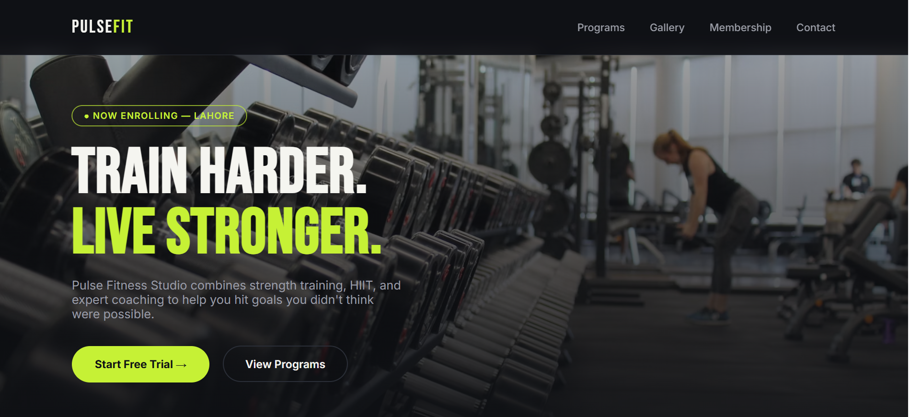

# 🏋️ Pulse Fitness Studio — Fitness Gym Website

A modern and responsive fitness gym website designed for **Pulse Fitness Studio**, featuring a bold visual style, fitness programs, membership plans, and contact options.

🌐 **Live Demo:** [View Website](https://fitnessgymwe.netlify.app/)

## ✨ Features

- Modern dark-themed design with lime-green accents
- Responsive navigation and hero section
- Fitness programs and personal coaching information
- Membership plans with pricing
- Fitness image gallery
- Contact section with a free-trial call to action
- Scroll reveal animations
- Responsive layout for different screen sizes
  ## 🖥️ Live Preview

Click the preview below to visit the live website.

🌐 **[Visit Live Website](https://fitnessgymwe.netlify.app/)**

## 🛠️ Technologies Used

- **HTML5** — Website structure
- **CSS3** — Styling, layout, responsive design, and animations
- **JavaScript** — Interactive behavior and scroll reveal effects
- **Google Fonts** — Typography

## 📋 Website Sections

- **Home:** Hero section introducing the fitness studio
- **Programs:** Strength Training, HIIT & Cardio, Yoga & Mobility, and 1-on-1 Coaching
- **Gallery:** Fitness and workout imagery
- **Membership Plans:** Basic, Pro, and Elite pricing options
- **Contact:** Free-trial call to action

## 🚀 Getting Started

1. Clone or download this repository.
2. Open the project folder.
3. Open the main HTML file in your browser.

No additional installation is required for this standalone HTML project.

## 🎯 Project Goal

The goal of this project is to create an engaging online presence for a fitness studio and present its programs, membership options, and contact information in a clean, modern layout.

## 👩‍💻 Author

**Fiza Batool**

- GitHub: [Fiza-batool](https://github.com/Fiza-batool)

---

© 2026 Pulse Fitness Studio. All rights reserved.
